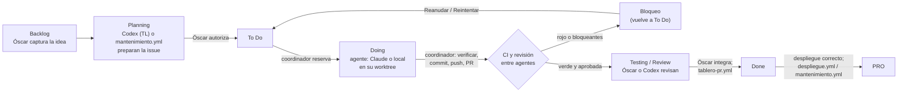

# Arquitectura

[← Índice de la documentación](README.md)

Codex (TL) publica issues en GitHub → `coordinador.py` las recoge → Claude Code u OpenCode + Ollama
trabajan en un `git worktree` propio → el coordinador verifica alcance y pruebas y abre **una** PR
por issue → Codex revisa. Solo biblioteca estándar de Python 3.9+. La v3 estaba pensada para **Windows nativo**
(PowerShell), donde están tu sesión de `claude`, `gh` y el servicio de Ollama; la v4 se usa desde WSL (ver
[Instalación](instalacion.md)).

## Piezas

```
equipo-ia-lab/
  equipo.py · panel.py · panel.html     ← gestión de proyectos y panel web local
  equipo.json                            ← compartido: agentes, modelo local, límites
  lecciones/                             ← compartidas: lo que aprende el agente local sirve en todos
  proyectos/<nombre>/                    ← por proyecto: config.json, estado/, worktrees/, repo/
```

- **`equipo.py`**: un solo equipo instalado y varios proyectos configurados. `proyectos`, `panel`,
  `<proyecto> vigilar|una-vez|estado|parar|reanudar N|diagnostico|leccion …`, `<proyecto> tablero …`,
  `importar`, `nuevo` y `migrar`. Para cada proyecto lanza el coordinador con su configuración.
- **`coordinador.py`**: diagnóstico, una-vez, vigilar, parar, estado, reanudar, probar, configurar-local.
  Recoge las tareas de To Do, invoca al agente, verifica, publica la PR y espera la CI y la revisión.
- **`tablero.py`**: el GitHub Project del proyecto: `crear`, `verificar`, `rehacer`, `migrar`, `ver`, `nueva`,
  `siguiente` (ver [Tablero](tablero.md)). Su lógica compartida está en `repo-plantilla/.equipo-ia/tablero_lib.py`.
- **`panel.py` + `panel.html`**: el [panel](panel.md) web local (127.0.0.1).
- **`repo-plantilla/`**: lo que se instala en cada repo gestionado: `.github/workflows/` (ver
  [Mantenimiento](mantenimiento.md#workflows-de-github-actions)) y `.equipo-ia/` (`tablero_lib.py`,
  `mantenimiento.py`, `mantenimiento.json`, `sincronizar.py`, `aviso_critico.py`, `plantilla-propuesta.md`).
- **`proyectos/<nombre>/`**: `config.json`, `estado/` (registro, logs, prompts, progreso), `worktrees/` y `repo/`
  de cada proyecto. Queda fuera de git.
- **`ensayo.py`, `ensayo_tablero.py`, `pruebas-dobles/`**: ensayos y dobles de GitHub, agentes y Ollama (ver
  [CI y pruebas](ci-y-pruebas.md)).

Disposición de una instalación de un solo proyecto (v3; en la v4 `config.json`, `repo/`, `worktrees/` y `estado/`
viven dentro de `proyectos/<nombre>/`):

```
equipo-ia-lab/
  coordinador.py      diagnóstico, una-vez, vigilar, parar, estado, reanudar, probar, configurar-local
  ensayo.py           fases 3-4: preparar-repo, crear-issues, caida-tras-push, unicidad, integrar, ollama-caida
  config.json         configuración de confianza (repo, autor, agentes, comandos de prueba)
  opencode.json       modelo y permisos de OpenCode; se hereda en worktrees/ y estado/pruebas/
  plantillas/         issue form, plantilla para Codex, contrato del piloto, opencode v1/v2
  repo/               clon del repositorio de ensayo        (se crea)
  worktrees/issue-N   un worktree y una rama por tarea      (se crea)
  estado/             registro.db, logs/issue-N, prompts, ensayo-resultados.json
  pruebas-dobles/     gh/claude/opencode/Ollama falsos para probar el coordinador sin red
```

## Pasos del coordinador

Cada tarea avanza por `PASOS` (en `coordinador.py`); el registro guarda el último paso hecho, así que
`reanudar N` sigue desde el pendiente y `reanudar N --desde <paso>` repite desde ese:

| Paso | Qué pasa |
|---|---|
| `reservada` | Reserva atómica en `registro.db` y tarjeta a Doing. |
| `worktree` | Worktree y rama `agente/<agente>/issue-N` desde la base. |
| `agente` | Se invoca al agente con el prompt (tarea, lecciones, fallos anteriores). |
| `verificada` | Archivos cambiados ⊆ «Archivos permitidos», diff guardado y pruebas de la issue. |
| `commit` | Commit de los cambios permitidos. |
| `push` | Rama subida al remoto. |
| `pr` | Una sola PR por issue (`Closes #N`); borrador si espera a la CI. |
| `ci` | Espera a la CI del proyecto (o pruebas locales); conflictos y commits ajenos. |
| `revision-agentes` | Rondas de revisión entre agentes (ver [Agentes y lecciones](agentes-y-lecciones.md)). |
| `review` | PR lista, etiqueta `review` y tarjeta en Testing / Review. |

## Reglas que aplica el coordinador

- Solo issues **abiertas, autorizadas (To Do; en el piloto, etiqueta `ready`), del autor autorizado y del repo
  configurado**; las demás se ignoran.
- Reserva atómica en `estado/registro.db` (repo + issue) y cerrojo `estado/coordinador.lock`: un único
  coordinador; un trabajador por proveedor; máximo 5 (`max_trabajadores`).
- El texto de la issue es **dato**: va al agente por stdin (Claude) o como archivo adjunto (OpenCode),
  nunca a un shell. `Comando de prueba` es una clave de `config.json → pruebas`.
- Antes de publicar: archivos cambiados ⊆ `Archivos permitidos`, diff guardado en `estado/logs`, pruebas.
  Después: push, una sola PR (`Closes #N`, agente, commit base, comandos y resultado) y etiqueta `review`.
- `blocked` (campo Bloqueo en el tablero) con comentario (causa, recuperación, log, worktree conservado) ante
  cuota, permisos, tiempo máximo, agente sin cambios, diff fuera de alcance, pruebas fallidas u Ollama caído. Un
  reintento con espera para errores de red. Al reiniciar reconcilia registro, rama remota y PR y solo repite lo
  pendiente.
- Sin relevo: si Ollama no responde, la tarea local se bloquea; nunca pasa a otro proveedor.

## Flujo Backlog → PRO


